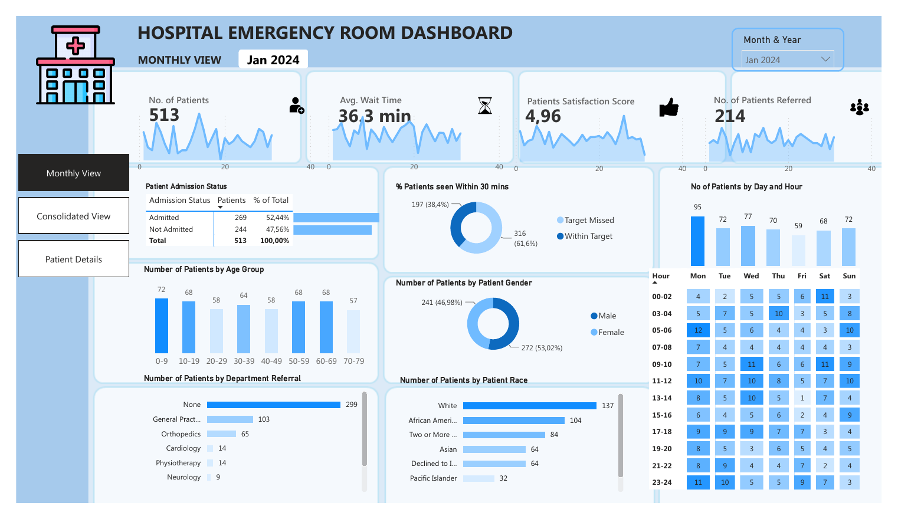
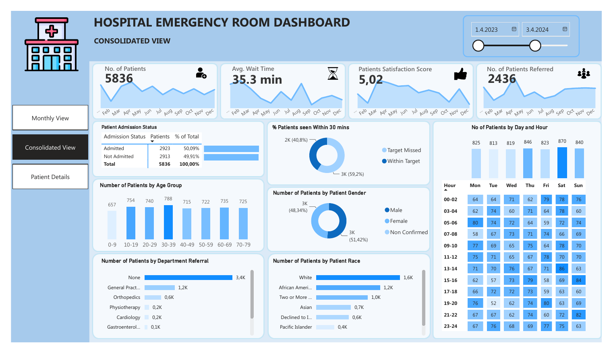

# Hospital Emergency Room Dashboard – Power BI

An interactive three-page Power BI report for an emergency room: patient volume, waiting times against a 30-minute target, patient satisfaction, admissions and referrals, with a monthly view, a consolidated date-range view and a patient-level table.

**Tools:** Power BI · DAX · Power Query · Date table
**Data:** 9,216 ER visits from 1 Apr 2023 to 30 Oct 2024 (`Hospital ER_Data.csv`, 12 columns)

## Business questions

1. How many patients does the ER see, and when is it busiest (day of week and hour)?
2. What share of patients is seen within the 30-minute target, and what is the average wait?
3. How satisfied are patients?
4. How many patients are admitted or referred to a department?
5. What does the patient mix look like (age, gender, race)?

## Report pages

### 1. Monthly View
Select a month and see KPI cards (number of patients, average wait time, satisfaction score, patients referred) with daily trends, admission status, share of patients seen within 30 minutes, age group, gender, department referral, race, and a day-by-hour heatmap of patient arrivals.



### 2. Consolidated View
The same KPIs and breakdowns for any date range chosen with the date slider, with monthly trend lines.



### 3. Patient Details
A record-level table (patient ID, name, gender, age, admission date, race, wait time, department referral, admission status) for drill-down. It is not pictured here because it lists individual patient records.

## Key findings

All figures were recomputed from the raw CSV (the whole dataset, independent of the date slicers) and match the dashboard.

- **Volume:** 9,216 visits over 19 months, about **485 per month** (lowest 431 in Feb 2024, highest 530 in Aug 2024). January 2024, shown on the Monthly page, had 513 patients, a 36.3-minute average wait, a 4.96 satisfaction score and 214 referrals.
- **Wait-time target:** **40.7%** of patients were seen within 30 minutes. The average wait is **35.3 minutes** (range 10–60).
- **Admissions:** the split is almost even, with **4,612 patients admitted (50.0%)**.
- **Referrals:** **41.4%** of patients (3,816) were referred to a department; General Practice (20.0%) and Orthopedics (10.8%) are the largest.
- **Demand is evenly spread:** Saturday is the busiest day (1,377 visits) and Wednesday the quietest (1,260), a difference of about 9%. Average wait time stays between 34.9 and 35.7 minutes across all days of the week.
- **Satisfaction:** the average score is **4.99 on a 0–10 scale**, and it shows almost no relationship with wait time (correlation −0.02).

## Data notes and limitations

- Only **27.3%** of visits have a satisfaction score, so the average is based on the patients who responded.
- The distributions are very even (wait times, day and hour of arrival, satisfaction), which suggests a sample or synthetic dataset. The findings illustrate the analysis and do not describe a real hospital.
- The trend charts on the Consolidated page group by month name, so use a date range of up to 12 months (for example 1 Apr 2023 – 31 Mar 2024). A longer range would combine the same month from two different years.
- "Patients referred" counts patients whose department referral is anything other than "None".

## Data model and key measures

**Model:** a fact table, `Hospital Data` (9,216 rows), related to a `Date` table (`CALENDAR` from the first to the last admission date) through `Patient Admin Date`, a date-only column derived from the admission date-time so that the time of day does not break the relationship. All measures live in a `_Measure` table.

**Power Query steps:** typed the columns, parsed the admission date-time with an explicit locale, recoded gender (M/F/NC → Male/Female/Non Confirmed), built the patient full name, and added the age group and admission hour.

**Calculated columns (DAX):**
- `Admission Status` (Admitted / Not Admitted) from the admission flag
- `Waittime` (Within Target if wait ≤ 30 minutes, otherwise Target Missed)
- `Waittime Interval`, a two-hour bucket of the admission hour used in the heatmap

**Key measures (DAX):**

```DAX
Number of Patients = DISTINCTCOUNT('Hospital Data'[Patient Id])

Average Wait Time = AVERAGE('Hospital Data'[Patient Waittime])

Patient Satisfaction Score = AVERAGE('Hospital Data'[Patient Satisfaction Score])

Patient Referred =
CALCULATE([Number of Patients], 'Hospital Data'[Department Referral] <> "None")

Admitted =
CALCULATE([Number of Patients], 'Hospital Data'[Patient Admission Flag] = TRUE())

Avg. Wait Time w/min = ROUND([Average Wait Time], 1) & " min"
```

## How to open

1. Download `Hospital Emergency.pbix` and `Hospital ER_Data.csv` from this repository.
2. Open the `.pbix` in Power BI Desktop and, if prompted, point the data source to your local copy of the CSV.
